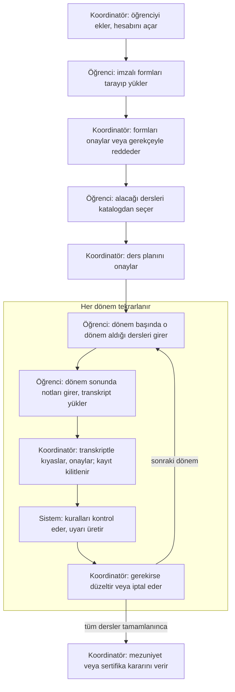
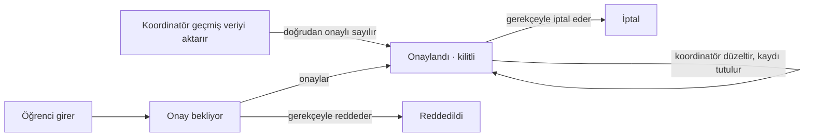

# Çift Anadal ve Yandal Otomasyonu — Proje Taslağı

> 11 Ekim 2026 sürümü. Bu dosya, koordinatörün sistem çerçevesi e-postasına göre yeniden yazılan taslağın metin kopyasıdır. Asıl hali (şemalarla birlikte): https://claude.ai/code/artifact/24bec6f7-4e86-4f99-9a9a-9dc3ccb1a677

## 1. Proje Özeti ve Kapsam

Bu sistem, Bilgisayar Mühendisliği Bölümü'ne gelen Çift Anadal (ÇAP) ve Yandal (YDP) öğrencilerinin bugün form ve kâğıt üzerinden elle yürütülen takibini tek bir web uygulamasına taşır. Sistemin merkezinde ders takibi vardır: öğrencinin alacağı her dersin hangi dönemde alındığı, notu ve durumu onaylı kayıtlar üzerinden izlenir.

**Kapsam içi**

- Koordinatörün, Dekanlıkça kabul edilen öğrenciyi sisteme eklemesi ve hesabını açması
- Ders planı, dönemlik ders kayıtları, notlar ve her dersin ayrı ayrı görülen denemeleri
- Belge arşivi, ek belge talepleri ve sistem içi mesajlaşma
- Onay mekanizması: öğrenci girer, koordinatör onaylar veya gerekçesiyle reddeder
- Yönerge kurallarına göre uyarılar; mezuniyet, sertifika ve kayıt silme kararlarının kaydı
- Değiştirilemez işlem kaydı ve bölüm başkanı için salt okunur izleme

**Kapsam dışı**

- Başvuru değerlendirme ve öğrenci seçimi: Dekanlık yapar ve bölüme bildirir.
- Öğrencinin ana dalındaki dersler ve süreçler.
- OBİS bağlantısı: şimdi yapılmaz; veri yapısı ileride eklenebilecek şekilde tasarlanır (Bölüm 5).

ÇAP ve YDP öğrencileri aynı sistemde yönetilir. İki program arasındaki farklar (eşikler, ders ve kredi sayıları, sonuç belgesi) kural ayarlarından gelir.

**Temel akış** (taslaktaki şemanın metin hali; 3 kulvar: Öğrenci, Koordinatör, Sistem)

Öğrenci her kaydı girer, koordinatör onaylar. Dönem döngüsü öğrenci tüm dersleri tamamlayana kadar sürer; son kararı koordinatör verir.

## 2. Kullanılacak Teknolojiler

Uygulama; React ön yüz, Node.js/Express REST API ve PostgreSQL veritabanından oluşan üç katmanlı bir web uygulamasıdır. Tüm yazma işlemleri tek bir servis katmanından geçer; ileride OBİS'ten gelecek veriler de aynı katmanı kullanır.

| Katman | Teknoloji | Gerekçe |
| --- | --- | --- |
| Ön yüz | React + Vite, React Router | Role göre sayfalar, hızlı geliştirme |
| Arayüz | MUI (Material UI), Türkçe arayüz | Hazır tablo, form ve dosya yükleme bileşenleri |
| Arka yüz | Node.js (LTS) + Express | REST API, onay mantığı ve kural motoru |
| Veritabanı | PostgreSQL + Prisma ORM | İlişkisel veri, şema göçleri, parametreli sorgular |
| Kimlik doğrulama | Argon2 ile şifre özeti, httpOnly çerezde JWT | Güvenli oturum; hesapları yalnız koordinatör açar |
| Girdi doğrulama | Zod şemaları | Her girdi sunucuda doğrulanır; içe aktarmada da aynı kurallar çalışır |
| Dosya işlemleri | Multer, dosya imzası (magic number) kontrolü, ClamAV | Tür ve boyut sınırı, bozuk ve zararlı dosyaya karşı koruma |
| Güvenlik | helmet, express-rate-limit, CSRF koruması | Güvenlik başlıkları, kaba kuvvet ve CSRF saldırılarına karşı koruma |
| Bildirim | Uygulama içi bildirim + Nodemailer (okul e-postası) | Yeni mesaj, onay sonucu ve uyarı bildirimi |
| Test | Vitest, Supertest, OWASP ZAP | Kural motoru ve API testleri, sızma testi |
| Çalıştırma | Docker Compose | Uygulama ve veritabanı yerel test ortamında tek komutla çalışır |

## 3. Kullanıcı Rolleri ve Yetkileri

Sistemde üç rol vardır ve başka rol yoktur. Hesapları koordinatör açar; öğrenciler kendi kendine kayıt olamaz.

| Rol | Kim | Temel yetki |
| --- | --- | --- |
| Koordinatör | Sistemin genel yöneticisi (ÇAP/YDP koordinatörü) | Öğrenci ve hesap, ders kataloğu, onaylar, kural ayarları ve kararlar |
| Öğrenci | Bölüme kayıtlı ÇAP veya YDP öğrencisi | Yalnız kendi kartı: ders, not ve belge girer, koordinatörle yazışır |
| Bölüm başkanı | Bilgisayar Mühendisliği Bölüm Başkanı | Yalnız izler: kayıtları ve işlem geçmişini görür, hiçbir şeyi değiştiremez |

**Giriş yöntemi:** Koordinatör hesabı açınca okul e-postasına tek kullanımlık ve süreli bir şifre belirleme bağlantısı gider. Sonraki girişler okul e-postası ve şifreyle yapılır; art arda hatalı denemelerde hesap geçici olarak kilitlenir.

**Yetki matrisi** (✓ = yapabilir, G = yalnız görür, – = erişemez)

| İşlem | Koordinatör | Öğrenci | Bölüm başkanı |
| --- | --- | --- | --- |
| Öğrenci ekleme, hesap açma ve kapatma | ✓ | – | – |
| Öğrenci kartını görme | Tüm öğrenciler | Yalnız kendi kartı | Tüm öğrenciler (G) |
| Ders planına ders ekleme veya çıkarma | ✓ (gerekçeli) | Kendi planına ekler, onaya gider | – |
| Katalog dışı ders talebi | Yanıtlar | Gönderir | G |
| Dönemlik ders ve not girişi | ✓ (düzeltme kayda geçer) | Kendi kaydı, onaya gider | G |
| Belge yükleme | Her öğrenciye, her türde | Yalnız kendi kartına | G |
| Kayıt ve belge onayı veya reddi | ✓ | – | G |
| Ek belge veya bilgi isteme | ✓ | Yanıtlar | G |
| Mesajlaşma | Tüm öğrencilerle | Yalnız kendi yazışmaları | – |
| Öğrenci kartına özel not | ✓ | Göremez | – |
| Anadal GANO girişi (kaynağıyla) | ✓ | G | G |
| Ders kataloğu düzenleme | ✓ | Arama yapar | G |
| Kural ve sistem ayarları | ✓ | – | G |
| Mezuniyet, sertifika, kayıt silme kararı | ✓ | Sonucu görür | G |
| İşlem kaydı ve raporlar | ✓ | – | G |
| Kayıt veya belge silme | Silinmez, iptal işaretlenir | – | – |

Yetkiler yalnız arayüzde değil, her API isteğinde sunucuda kontrol edilir. Öğrenci, adres çubuğundaki numarayı değiştirerek başka bir öğrencinin kaydına erişemez.

## 4. Temel Ekranlar ve Modüller

Sistem 12 modülden oluşur; merkezde öğrenci kartı ve ders takibi vardır. Her rol giriş yaptığında yalnız kendi ekranlarını görür.

| # | Modül | Temel ekranlar ve işlevler | Roller |
| --- | --- | --- | --- |
| 1 | Giriş ve hesap | Giriş, şifre belirleme bağlantısı, şifre sıfırlama, oturum kapatma | Tümü |
| 2 | Ana panel | Koordinatör: onay bekleyenler, yeni mesajlar, açık uyarılar. Öğrenci: tamamlanan ve kalan AKTS, bekleyen işlemler, belge talepleri. Bölüm başkanı: genel durum özeti | Tümü |
| 3 | Öğrenci yönetimi | Öğrenci listesi ve arama; öğrenci ekleme (öğrenci no, ad soyad, okul e-postası, ÇAP/YDP, kabul dönemi); mevcut öğrenciler için geçmiş dönem aktarımı | Koordinatör, bölüm başkanı (G) |
| 4 | Öğrenci kartı | Kimlik ve program bilgisi, anadal GANO geçmişi (kaynağıyla), ders planı, belgeler, mesajlar, özel notlar, uyarılar, kararlar, işlem geçmişi | Tümü (öğrenci yalnız kendi kartını, özel notlar hariç) |
| 5 | Ders kataloğu ve protokoller | Ders ekleme, güncelleme, pasife alma; kod veya adla arama; anadal bölümüne göre protokol ders listeleri | Koordinatör (diğerleri arar ve görür) |
| 6 | Ders planı ve takibi | Alınacak dersler; her ders için alındığı ve geçildiği dönem, not ve durum; her deneme ayrı satır; tamamlanan ve kalan AKTS özeti; katalog dışı ders talebi | Tümü |
| 7 | Dönem işlemleri | Dönem başında o dönem alınan derslerin girişi; dönem sonunda not girişi, ÇAP/YDP transkripti (zorunlu) ve anadal transkripti (isteğe bağlı) yükleme | Öğrenci, koordinatör |
| 8 | Onay merkezi | Bekleyen ders, not ve belgeler; transkriptle karşılaştırarak tek tek veya toplu onay; gerekçeli ret, düzeltme ve iptal | Koordinatör |
| 9 | Belge arşivi ve talepler | Tür ve durumuyla belge listesi, sürüm geçmişi, belge yükleme; ek belge talebi ve takibi | Tümü |
| 10 | Mesajlaşma ve bildirimler | Öğrenci–koordinatör yazışması, dosya eki, okunmamış mesaj göstergesi, e-posta bildirimi | Öğrenci, koordinatör |
| 11 | Kurallar ve uyarılar | Sürümlü kural parametreleri, uyarı listesi, uyarıdan karara geçiş (mezuniyet, sertifika, kayıt silme) | Koordinatör, bölüm başkanı (G) |
| 12 | İşlem kaydı ve raporlar | Kim, ne zaman, neyi, eski ve yeni değeriyle; filtreleme; öğrenci ve durum raporları | Koordinatör, bölüm başkanı |

**Onay mantığı.** Öğrencinin girdiği ders, not ve belgeler "onay bekliyor" durumunda başlar ve onaylanana kadar kural hesaplarına girmez. Onaylanan kayıt kilitlenir; hata varsa yalnız koordinatör düzeltir ve düzeltme işlem kaydına yazılır.

**Kayıt onay durumları** (taslaktaki şemanın metin hali)

Reddedilen ve iptal edilen kayıtlar o durumuyla arşivde kalır. Mevcut öğrencilerin geçmiş verisi onay kuyruğuna girmeden onaylı sayılır.

## 5. Sistemde Tutulacak Veriler ve Belgeler

Veriler PostgreSQL'de, dosyalar web kökü dışındaki bir depolama klasöründe tutulur. Hiçbir kayıt fiziksel olarak silinmez; yanlış veya geçersiz kayıtlar "iptal" olarak işaretlenir.

| Tablo | Başlıca alanlar |
| --- | --- |
| Kullanıcı | rol, okul e-postası, şifre özeti, hesap durumu, son giriş |
| Öğrenci | öğrenci no (benzersiz anahtar), ad soyad, okul e-postası, program türü (ÇAP/YDP), anadal bölümü, kabul dönemi, ÇAP öğrenci no, durum |
| Akademik dönem | yıl ve dönem (ör. 2025-2026 Güz), başlangıç ve bitiş tarihi |
| Ders kataloğu | ders kodu, ad, AKTS, ulusal kredi, yarıyıl, zorunlu/seçmeli, aktif/pasif |
| Protokol şablonu | anadal bölümü, ders satırları (ders veya seçmeli yuvası, AKTS), özel şart dipnotları |
| Ders planı | öğrenci, ders, ekleme veya çıkarma tarihi ve gerekçesi |
| Ders denemesi | öğrenci, ders, alındığı dönem, not, durum, geçildiği dönem, onay durumu, veri kaynağı |
| Anadal GANO kaydı | öğrenci, dönem, değer, kaynak (transkript, öğrenci işleri), giren koordinatör |
| Belge | öğrenci, tür, dosya, sürüm no, önceki sürüm, durum, yükleyen, tarih, dosya özeti (SHA-256) |
| Belge talebi | öğrenci, istenen belge veya bilgi, durum, yanıt, tarihler |
| Mesaj | yazışma, gönderen, metin, ek, okunma zamanı |
| Koordinatör notu | öğrenci, not, tarih (öğrenci göremez) |
| Kural sürümü | parametre, değer, geçerlilik başlangıcı, dayanak madde |
| Uyarı | öğrenci, kural, kullanılan kural sürümü, sonuç, tarih, durum (açık, kapatıldı) |
| Karar | öğrenci, tür (mezuniyet, sertifika, kayıt silme), gerekçe, tarih |
| Katalog dışı ders talebi | öğrenci, ders bilgisi, durum, yanıt |
| İşlem kaydı | kim, ne zaman, hangi kayıt, işlem, eski ve yeni değer (yalnız eklenir) |

**Belge türleri**

| Belge | Kim yükler | Ne zaman | Zorunlu mu |
| --- | --- | --- | --- |
| İmzalı Kabul ve Ders Protokolü | Öğrenci | Sisteme eklendikten sonra | Evet |
| İmzalı Ders Kayıt Formu (FORM01 veya Yandal formu) | Öğrenci | Kesin kayıtta | Evet |
| ÇAP/YDP transkripti (not belgesi) | Öğrenci | Her dönem sonunda | Evet; yüklenmeden notlar onaya gönderilemez |
| Anadal transkripti | Öğrenci | Dönem sonunda | İsteğe bağlı |
| Özel Şartlı Derslerin Muafiyeti Formu | Öğrenci | Mezuniyetten önce | Muafiyet istenirse |
| Yönetim kurulu yazısı ve diğer resmi yazılar | Koordinatör | Gerektiğinde | – |
| Ek istenen belge | Öğrenci | Talep üzerine | Talebe bağlı |

**Durum değerleri**

| Alan | Değerler |
| --- | --- |
| Kayıt onayı (ders, not, belge) | onay bekliyor, onaylandı (kilitli), reddedildi, iptal |
| Ders durumu | planlandı, alındı, geçti, kaldı, muaf, çıkarıldı |
| Belge talebi | bekliyor, yüklendi, onaylandı, reddedildi |
| Öğrenci | aktif, dondurulmuş, mezun, sertifika aldı, ayrıldı, kaydı silindi |

**OBİS'e hazırlık ve geçmiş veri**

- Öğrenci numarası tüm tablolarda benzersiz anahtardır.
- Öğrenci, ders ve not verisi tek bir veri giriş servisinden geçer. Elle giriş, CSV ile toplu aktarım ve ileride OBİS aynı doğrulamayı kullanır; her kayıtta veri kaynağı tutulur.
- Mevcut öğrencilerin önceki dönem ders ve notlarını koordinatör "geçmiş aktarım" kaynağıyla girer. Bu kayıtlar onay kuyruğuna düşmeden onaylı sayılır ve işlem kaydına yazılır.

## 6. Otomatik Kontrol Edilecek Yönetmelik Kuralları

Sistem öğrencinin durumunu aşağıdaki 18 kurala göre kontrol eder; koordinatörü ve ilgili öğrenciyi uyarır. Uyarı karar değildir, kararı koordinatör verir.

**İlkeler**

- Yalnız onaylı kayıtlar hesaba girer.
- Sayısal değerler (GANO eşikleri, dönem sınırları, ders ve AKTS sayıları, süreler) koda gömülmez; koordinatör ayarlardan girer.
- Yönerge değişince yeni değer yeni bir sürüm olarak eklenir, eski sürüm silinmez. Her uyarı hesaplandığı kural sürümüyle saklanır; geçmiş kontroller yeni değerle yeniden yazılmaz.
- Eşiklerde kullanılan anadal GANO'yu yalnız koordinatör girer ve kaynağını yazar. ÇAP/YDP ortalaması onaylı notlardan hesaplanır; harf notu katsayıları da ayardadır.

**Çift Anadal (madde numaraları: Çift Ana Dal Yönergesi, 2026)**

| Kod | Kural | Ayardaki değer | Dayanak | Kontrol anı |
| --- | --- | --- | --- | --- |
| Ç1 | Ders planı, anadal bölümünün protokolüyle karşılaştırılır; eksik dersler gösterilir | Protokol listesi | Md. 7/2; protokol | Plan onayında |
| Ç2 | Anadal GANO 2,72'nin altına ilk düşüşte uyarı; ikinci düşüşte kayıt silme uyarısı | 2,72 / 2,50 | Md. 9/1-e | GANO girişinde |
| Ç3 | Mazeretsiz iki dönem üst üste ders almayan öğrenci için kayıt silme uyarısı | 2 dönem | Md. 9/1-d | Dönem sonu |
| Ç4 | Kaydı dondurulan öğrencide ders alma ve süre kontrolleri durdurulur | – | Md. 9/1-ç | Durum değişince |
| Ç5 | Azami süre kabul döneminden itibaren işler; son iki dönemde uyarı, aşılınca ilişik kesme uyarısı | 7 yıl (4 yıllık program) | Md. 8/1-d, 9/1-g | Dönem sonu |
| Ç6 | Mezuniyete uygunluk: plan derslerinin tamamı geçti veya muaf, anadal mezuniyeti var, anadal GANO en az 2,72 | 2,72 | Md. 8/1-c, ç | Her onayda |
| Ç7 | Ayrılan veya kaydı silinen öğrencinin dersleri yandal şartını karşılıyorsa sertifika uyarısı | YDP değerleri | Md. 8/1-g | Durum değişince |

**Yandal (madde numaraları: Yan Dal Yönergesi, 2023)**

| Kod | Kural | Ayardaki değer | Dayanak | Kontrol anı |
| --- | --- | --- | --- | --- |
| Y1 | Ders planı en az 30 AKTS ve en az 6 dersten oluşmalı | 30 AKTS, 6 ders | Md. 5/1-g | Plan onayında |
| Y2 | Dönem sonunda anadal GANO 2,30'un altındaysa kayıt silme uyarısı | 2,30 | Md. 7/5 | GANO girişinde |
| Y3 | Yandal ortalaması üst üste iki dönem 2,00'ın altındaysa kayıt silme uyarısı | 2,00 / 2 dönem | Md. 7/6 | Dönem sonu |
| Y4 | İzinsiz iki dönem üst üste ders almayan öğrenci için kayıt silme uyarısı | 2 dönem | Md. 7/4 | Dönem sonu |
| Y5 | Sertifikaya uygunluk: anadal mezuniyeti var ve yandal ortalaması en az 2,00 | 2,00 | Md. 7/8 | Her onayda |
| Y6 | Anadal mezuniyetinden sonra en çok iki yarıyıl ek süre verilir | 2 yarıyıl | Md. 7/9 | Dönem sonu |
| Y7 | Kaydı silinmiş öğrenci aynı yandala yeniden eklenemez | – | Md. 7/11 | Öğrenci eklenirken |

**Ortak sistem kuralları**

| Kod | Kural | Dayanak | Kontrol anı |
| --- | --- | --- | --- |
| S1 | Bir öğrenci ya ÇAP ya YDP öğrencisi olarak kayıtlıdır | ÇAP Yön. Md. 5/1-ğ | Öğrenci eklenirken |
| S2 | Dönem sonu notları, ÇAP/YDP transkripti yüklenmeden onaya gönderilemez | Koordinatör çerçevesi | Not gönderiminde |
| S3 | Katalogda olmayan ders girilemez; öğrenci talep gönderir | Koordinatör çerçevesi | Ders girişinde |
| S4 | Kalınan ders yeniden alınabilir; her deneme ayrı tutulur, ortalamaya giren deneme ayardan belirlenir | Sınav Yönetmeliği | Not onayında |

## 7. Güvenlik Önlemleri ve Sızma Testleri

Sistemde yalnız sentetik veri kullanılır. Testler yalnız kendi geliştirdiğimiz uygulamada, kendi bilgisayarımızdaki yerel test ortamında yapılır.

| Risk | Önlem |
| --- | --- |
| Öğrencinin başka bir öğrencinin kaydına erişmesi (IDOR) | Her istekte rol ve kayıt sahipliği kontrolü; tahmin edilemeyen kayıt kimlikleri (UUID) |
| Bölüm başkanının veri değiştirmesi | Salt okunur rol sunucuda zorlanır; yazma uçları yalnız koordinatöre açık |
| Kaba kuvvetle şifre deneme | Argon2 ile şifre özeti, giriş deneme sınırı, geçici hesap kilidi |
| Oturum çalma | httpOnly, Secure ve SameSite çerezde kısa süreli oturum |
| SQL enjeksiyonu | Prisma ile parametreli sorgular; ham SQL kullanılmaz |
| XSS | React'in otomatik kaçışlaması, mesajlarda HTML'e izin verilmez, CSP başlığı |
| CSRF | SameSite çerez ve CSRF jetonu |
| Zararlı veya bozuk dosya | Yalnız PDF, JPG ve PNG; 10 MB sınırı; dosya imzası kontrolü; ClamAV taraması; rastgele dosya adı; web kökü dışında saklama; yalnız yetkili indirme |
| Kayıtların sonradan değiştirilmesi | Fiziksel silme yok; işlem kaydı yalnız eklenir, veritabanı yetkisiyle güncelleme ve silme kapalıdır |
| Bağımlılık açıkları | npm audit ile düzenli tarama |

**Planlanan testler**

1. OWASP ZAP ile yerel ortamda otomatik tarama
2. Yetki testleri: A öğrencisinin hesabıyla B öğrencisinin kayıt ve belge adreslerine erişim denemesi; bölüm başkanı hesabıyla değişiklik isteği gönderme
3. Girdi testleri: form alanlarında ve mesajlarda SQL enjeksiyonu ve XSS denemeleri
4. Dosya testleri: uzantısı değiştirilmiş çalıştırılabilir dosya, boyut sınırı aşımı, bozuk PDF, EICAR test dosyası
5. Oturum testleri: art arda hatalı giriş, süresi dolmuş veya kullanılmış şifre bağlantısı

Test sonuçları ve alınan önlemler, tasarım açıklamasına kısaca eklenir.

## 8. Yönergeyle İlgili Notlar

Yönergeleri okurken aşağıdaki noktalar belirsiz kaldı. Sistemde bunlar varsayılan değerlerle ve ayardan değiştirilebilir şekilde ele alınır; koordinatörün görüşüne sunulur.

- **Md. 9/1-e ifadesi:** Yönerge "bir defaya mahsus 2,50'nin altına düşebilir" der; YÖK Yönetmeliği ise "65'e kadar düşebilir" der (65 = 2,50). İlk düşüşte 2,50'nin altına inen öğrenci için ne yapılacağı belirsizdir. Varsayılan: Yönetmelik yorumu, yani 2,50'nin altı kayıt silme uyarısıdır.
- **Rehberdeki madde numaraları:** Rehber (Şubat 2025) eski yönergeye atıf yapar. Md. 4 ve Md. 8'deki hükümler 2026 yönergesinde Md. 5 ve Md. 9'dadır; sistemde güncel numaralar kullanılır.
- **Muafiyet formu:** Özel Şartlı Derslerin Muafiyeti Formu rehberde geçer ama form setinde yoktur. Sistemde belge türü olarak tanımlanır; muafiyeti koordinatör bu belgeyle işaretler.
- **Öğrenci numarası:** FORM01 ayrı bir "Çift Anadal Öğrenci No" ister. Sistemde benzersiz anahtar anadal öğrenci numarasıdır; ÇAP numarası ek alan olarak tutulur.
- **Not hesabı:** Harf notu katsayıları ve tekrar edilen derste hangi notun geçerli olduğu Sınav Yönetmeliği'ne bağlıdır ve elimizdeki belgelerde yoktur. Bu değerler ayarlardan girilir.
